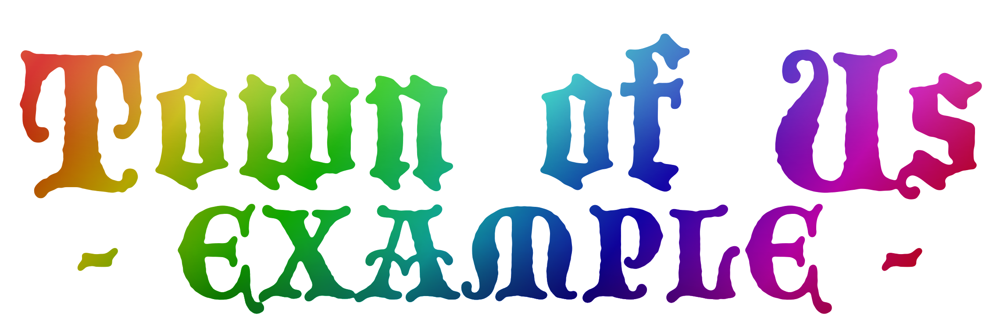

> [!NOTE]
> This extension is in active development, so expect some instabilities.

-----------------------

  
  
ECLIPSE: Fault's TOUM Expansion

 

A client-side [Among Us](https://store.steampowered.com/app/945360/Among_Us) mod that adds new features on top of [Town of Us: Mira](https://github.com/AU-Avengers/TOU-Mira).

-----------------------
# License
This software is distributed under the GNU GPLv3 License. BepInEx is distributed under the LGPL-2.1 License.

# Copyright

This mod is not affiliated with Among Us or Innersloth LLC, and the content contained therein is not endorsed or otherwise sponsored by Innersloth LLC. Portions of the materials contained herein are property of Innersloth LLC.

© Innersloth LLC.

